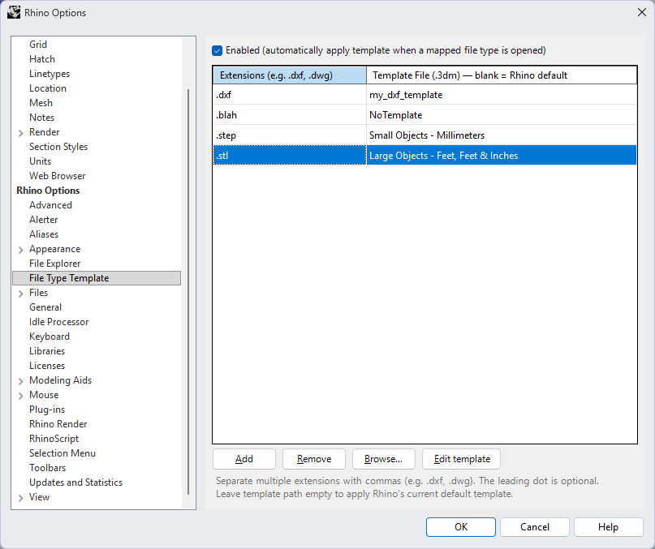

# vFileTypeTemplate  ·  v26.8.25.1813

vFileTypeTemplate is a Rhino 8 and Rhino 9 plug-in that applies a chosen Rhino template automatically after a mapped file type is opened.

## Features

- Maps one or more file extensions to a Rhino template.
- Applies mappings after a normal document open while ignoring merge and reference operations.
- Synchronizes document settings, notes, document strings, layers, linetypes, hatch patterns, dimension styles, materials, named views, named construction planes, and runtime settings.
- Uses a DXF file's `$INSUNITS` value for document units when available.
- Applies the operation in a Rhino undo record.

## Commands

| Command | Purpose |
| --- | --- |
| `vFileTypeTemplateConfig` | Open the mapping editor and enable or disable automatic application. |
| `vFileTypeTemplateApply` | Apply a specified template, or use the template mapped to the active document's file type. |

The configuration page is also available under Rhino's **Tools > Options > File Type Template**.

Run `vFileTypeTemplateApply` and enter a template path, choose **Browse**, or press Enter to use the mapped/default template. The `.3dm` extension is optional. Templates in Rhino's default template folder are shown and accepted by name without their folder or extension. The command remains available when automatic application is disabled. For scripted use:

```text
_-vFileTypeTemplateApply "<template-name-or-path>"
```



## Configuration

`vFileTypeTemplate.config.json` is stored beside the plug-in DLL. The repository includes these defaults:

```json
{
  "enabled": true,
  "mappings": [
    {
      "extension": ".dxf",
      "templatePath": ""
    }
  ]
}
```

An empty template path uses Rhino's default template. A bare template filename is resolved in Rhino's template folder, while an absolute path can point elsewhere. Missing configured templates are skipped without changing the opened document. Multiple comma-separated extensions can share one mapping in the configuration UI.

During every build, missing default properties are merged into the existing config in each framework output. Existing values and configured entries are never replaced.

## Build

From the repository folder:

```powershell
.\build.ps1
```

The default Release build does not require Git and never commits or pushes. Maintainers can use `.\build.ps1 -Publish` to build, create a signed semantic commit when the DLL changes, push `master`, and publish a GitHub release containing separate Rhino 8/.NET 7 and Rhino 9/.NET 10 DLLs, plus any generated `.rui` files.

## Installation

The Release plug-ins are:

- `bin/Release/Rhino8/net7.0-windows/vFileTypeTemplate.dll` for Rhino 8
- `bin/Release/Rhino9/net10.0-windows/vFileTypeTemplate.dll` for Rhino 9

Load it with Rhino's Plug-in Manager and keep `vFileTypeTemplate.config.json` beside the DLL when deploying predefined mappings.

Runtime diagnostics are written to `vFileTypeTemplate.log` beside the loaded DLL. The file is cleared at startup and begins with the Rhino and plug-in versions.

## Versioning

Build versions use `yy.m.d.hmm`, derived from the newest C# source file rather than the compile time.

## License

Released under the [MIT License](LICENSE).

## Host-Isolated Installation

The installed DLLs, settings, logs and companion files live directly in bin/Release/Rhino8/net7.0-windows, bin/Release/Rhino8/net10.0-windows and bin/Release/Rhino9/net10.0-windows. Rhino 8 variants reference the Rhino 8 SDK; Rhino 9 references Rhino 9. There is no separate deployment directory or post-build copying step. Debug outputs and compiler caches remain separate by host/runtime.

For existing installations, Register.ps1 -Register validates all three DLLs, restores the per-user startup registration request, and updates plug-in/toolbar paths silently. Use -IncludeMachine as an administrator to repair existing machine-wide entries too. Previous values are backed up under backups/registration. Run registration from ordinary Windows PowerShell or from Rhino, not a Codex Windows sandbox: its registry view can differ from Rhino, so sandbox writes are refused. Confirm discovery after a normal Rhino restart; an in-process test does not verify desktop startup. Subsequent builds update the same registered files. Existing configuration values are preserved while missing defaults are added; existing toolbars are never overwritten. Close Rhino before updating a locked Release DLL, run build.ps1 once, then reopen Rhino. Use Debug for verification while Release is in use. The global material database and Rhino-native settings remain in their existing stores.

build.ps1 is a standalone Release build without Git operations; -Rebuild forces compilation when C#-derived versions are unchanged. Publishing current Release outputs runs metadata-only targets without recompiling loaded runtime variants. When compilation is required and an output is locked, the build exits successfully with a warning and preserves the pending message. Publishing remains an explicit user action. GitHub version-tag workflows validate three prebuilt DLLs and package separate Rhino 8/9 ZIPs with repository defaults, help, toolbars and notices. They never ship installed profiles or logs, and retries add only missing assets without overwriting published files.
